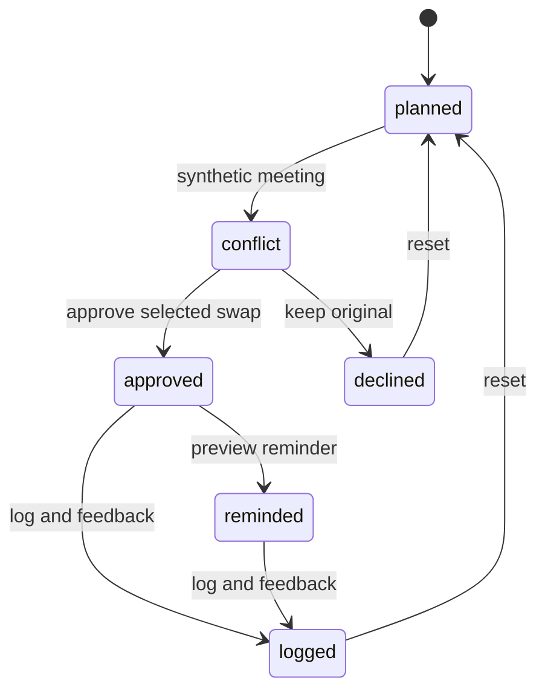

# Technical architecture

## Current build
Dependency-free ES modules, semantic HTML, responsive CSS and original local SVG. Node serves static files on loopback. A pure domain module owns fixtures, transitions and consumed-only totals. The UI reads that state and dispatches intent. Local storage key `nutrilife-demo-v1` persists state; exceptions trigger a visible in-memory fallback. Native dialogs contain detail and logging flows. A same-origin, project-scoped service worker caches only the shell. Relative asset URLs support GitHub Pages subdirectories. The mobile manifest supports a standalone home-screen launch.

State machine:

Any stage can reset. Water recording is independent. Ingredient exclusion toggles work before approval; feasible candidates are recomputed. Plan and reminder change together only in `approve`. Totals are recalculated from unique logged meal IDs. Logging is stage-gated; repeated clicks cannot append a second lunch.

## Domain records
- `Meal`: stable ID, name, ingredient description, time, minutes, kcal, protein/carbs/fat/fiber in grams, allergen tags, illustration key. All nutrition synthetic.
- `DemoState`: version, stage, selected candidate, actual lunch ID, logged IDs, feedback, reminder, water count, exclusions and event strings.
- Demo date and times are fixed narrative values in America/Indianapolis, not live scheduled jobs. “Reminder” is an in-app state, not a push delivery receipt.

## Production direction (not implemented)
Keep deterministic policy and transactional state transitions outside an LLM. Define adapters for CalendarContext (free/busy windows), FoodCatalog (verified nutrition plus source/version/confidence), Planner (constraint-satisfying proposals), ReminderDelivery (scheduled/cancelled/delivered states) and EventStore (versioned consent/approval history). An optional model may explain proposals; it must not bypass allergy checks, scope rules or approval.

Suggested evolution: typed front end; authenticated API; relational storage with row-level authorization; idempotent command IDs; background reminder queue; timezone-aware calendar adapters; structured audit events; notification preferences; consent-scoped telemetry. Use transactions or an outbox for plan/reminder changes and explicit partial-failure recovery. Revalidate proposal freshness at approval. Production safety review and threat model precede real health data.

## Security and privacy
No secrets or credentials. No third-party assets. No application outbound requests. Export is a local download; the optional guideline link is user initiated. Browser data is unencrypted, single-browser, untrusted and unsuitable for real health information. Strings displayed from stored events are escaped. State loading checks known identifiers and basic schema; it is not an authorization boundary. Server is a development convenience, not an internet-facing production server.

## Offline behavior
Internet disconnected + running local server is the primary reliable demo mode. Once the shell is cached, a service-worker fallback can serve it without the server. First-ever loading still requires the server. Browser support/storage policies may disable persistence/caching; keep the demo server running. Network-first shell fetches ease development; bump cache version for release changes. No food images/fonts need the internet.

## Hosted demo
GitHub Actions verifies the source and deploys only the generated `site/` web assets to GitHub Pages. The public source repository supports ongoing Codex development. Hosted visitors still keep their own synthetic state in browser local storage; there is no shared backend or cross-device sync. See PHONE-AND-HOSTING.md.
